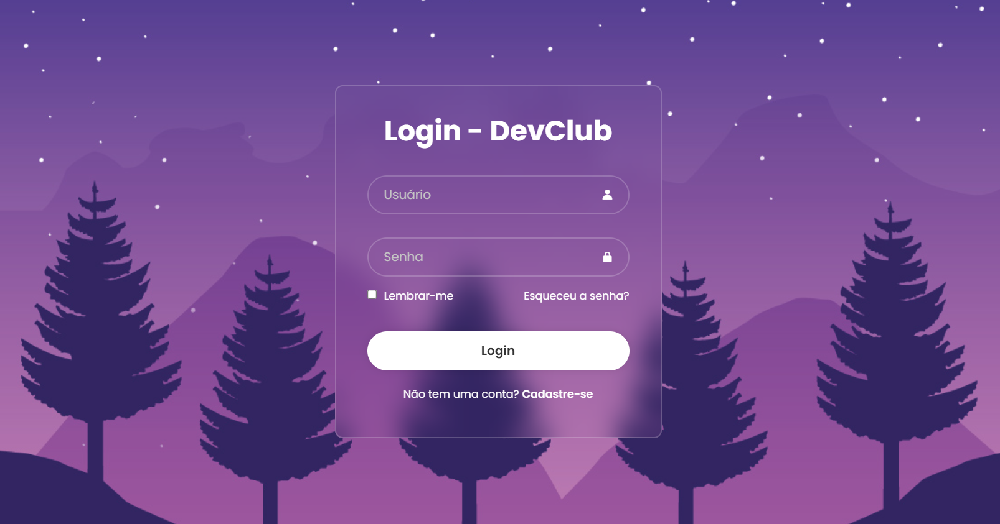

# DevClub - Tela de Login

Projeto de uma tela de login responsiva, desenvolvida com HTML e CSS. A interface apresenta campos de usuário e senha, opção para lembrar o acesso e links para recuperação de senha e cadastro.

> Este projeto é uma demonstração de interface. Não possui autenticação real nem conexão com um backend.

## Pré-visualização

Abra o arquivo `index.html` em um navegador para visualizar a tela.

## Tecnologias

- HTML5
- CSS3
- JavaScript
- Boxicons, carregado por CDN
- Google Fonts (Poppins)

## Estrutura

- `index.html` — estrutura da página e formulário.
- `style.css` — estilos e layout da tela.
- `alerta.js` — exibe uma mensagem de demonstração.
- `img/` — imagens utilizadas no projeto.

## Executar localmente

1. Baixe ou clone este projeto.
2. Abra `index.html` diretamente no navegador.

As fontes e os ícones são carregados de serviços externos, então é necessária uma conexão com a internet para exibi-los.

